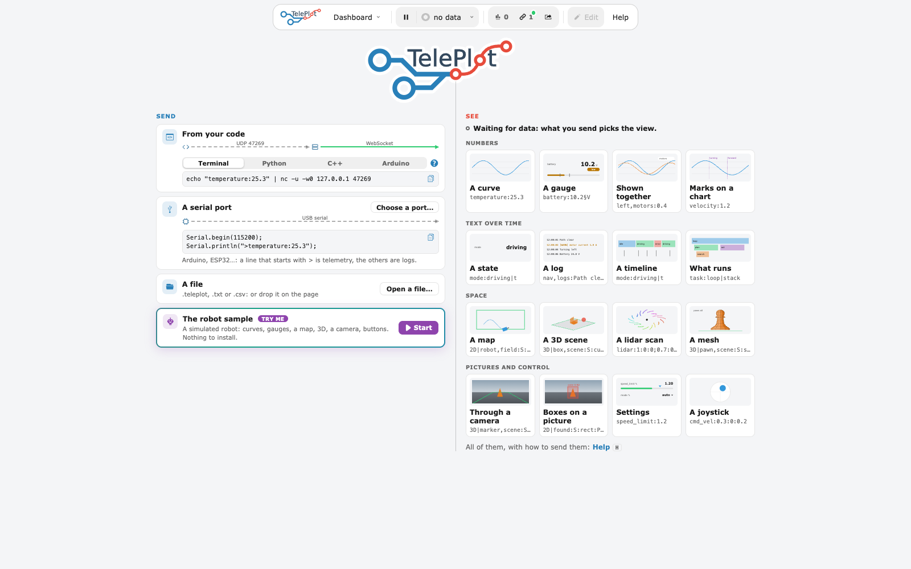
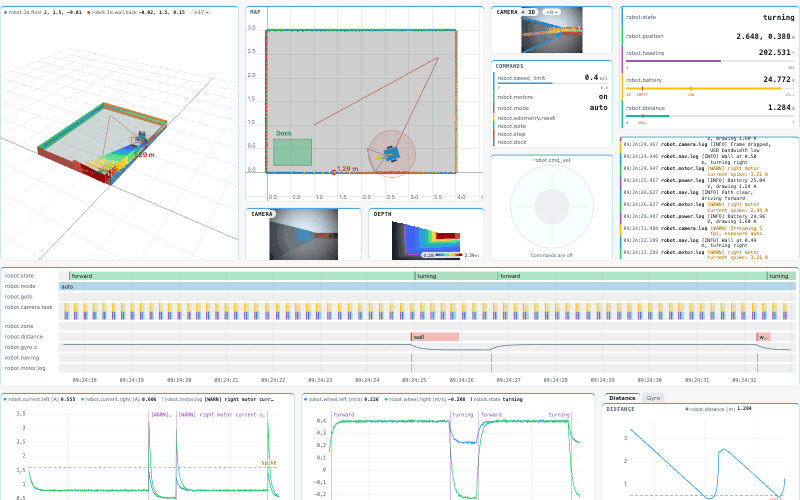

# Teleplot

A ridiculously simple tool to plot telemetry data from a running program, and to change its settings and call its functions from the
page.

```bash
echo "myData:4" | nc -u -w0 127.0.0.1 47269
```





*Above: the page waiting for data, then the robot sample (welcome screen, "Try me"): a simulated robot, nothing to install.*

Teleplot displays what your program sends, as it sends it: numbers as curves or gauges, texts as states, logs or timelines, state machines
and behavior trees, positions on a map, shapes, point clouds and cameras in 3D, pictures and depth maps. Send one line of text over UDP or a serial port, and it is
on screen; arrange dashboards by hand or from your code; keep the data in files; drive your robot from the page.

**Teleplot V2** (this branch, beta) is a rework of the library, the web application and the server, with a much faster display and
compatible with everything V1 programs send. **Teleplot V1** is online at [teleplot.fr](https://teleplot.fr) and as a
[VS Code extension](vscode/README.md): see "Teleplot V1" at the end.

## Start

Each [release](https://github.com/nesnes/teleplot/releases) of V2 comes with:

- `teleplot-linux-x64`, `teleplot-linux-arm64`, `teleplot-macos-arm64`, `teleplot-macos-x64`, `teleplot-win-x64.exe`: the server and
  the web application as one executable, nothing to install. Run it, open http://127.0.0.1:8080 and send UDP packets to port `47269`.
- `teleplot-server.zip`: the same as sources, for Node.js (`npm ci && node main.js`).
- `teleplot-webapp.zip`: the web application alone, static files to serve.
- `teleplot-js.js`: the library alone, one file to include in your own page.

The executables are not signed with a paid certificate, so the system asks before running one that was downloaded with a browser:

- Linux and macOS: make it executable with `chmod +x teleplot-macos-arm64`.
- macOS says it "could not verify" the file: close the dialog, then run `xattr -d com.apple.quarantine teleplot-macos-arm64` (or
  allow it in System Settings > Privacy & Security > Open Anyway).
- Windows SmartScreen: "More info", then "Run anyway".

From the sources:

```bash
cd packages/server
npm ci
node main.js
```

Then open http://127.0.0.1:8080. Options (ports, who can connect, other folders to serve): [doc/server.md](doc/server.md).

No device yet? Start the robot sample from the welcome screen, or open the **Help** panel: a gallery of everything Teleplot can
display, each with the lines that make it, in your language, and a Send button to try them.

## Send data

A telemetry is one line of text, `name:value`, sent as a UDP packet to port `47269`:

```
temperature:25.3                                   a number
temperature:1627551892437:25.3§°C                  with its time (ms) and its unit
position:1.2:0.8|xy                                a position on a map
motor:running|t                                    a state
events:Overcurrent detected|log                    a log line
left,motors:0.42                                   a label: telemetries of a label share a view
ATTR|battery|min=9|max=12.6                        a range: the value gets a gauge
TH|battery:low<10.5                                a threshold
3D|robot:S:cube:P:1:2:0:C:blue                     a 3D shape
2D|zone:S:polygon:PT:0:0:1:0:1:1:C:red:O:0.3       a 2D drawing
DASH|Robot/Motion:chart:speed,accel                a view of a dashboard
```

Everything the text protocol says: [doc/textProtocol.md](doc/textProtocol.md). A binary protocol says the same, more compactly:
[doc/binaryProtocol.md](doc/binaryProtocol.md).

### From a terminal

```bash
echo "myValue:1234" | nc -u -w0 127.0.0.1 47269
```

### Python

[`clients/python/teleplot.py`](clients/python/teleplot.py) ([README](clients/python/README.md)): one file, the API of the C++ client
(descriptions, shapes, pictures, settings and buttons...), examples one step at a time:

```python
from teleplot import Teleplot
tp = Teleplot.instance()
tp.telemetry("battery").unit("V").range(10.5, 12.6)
tp.update("battery", 12.4)
```

Or a plain socket:

```python
import socket, math, time

sock = socket.socket(socket.AF_INET, socket.SOCK_DGRAM)
t = 0
while True:
    sock.sendto(f"sin:{math.sin(t)}".encode(), ("127.0.0.1", 47269))
    t += 0.1
    time.sleep(0.01)
```

### C++

Copy [`clients/cpp/Teleplot.h`](clients/cpp/Teleplot.h) (one header, C++17, Linux / macOS / Windows) into your project. It speaks the binary protocol and sends
by itself every 20 ms. Its companion `TeleplotImage.h` turns the pixels of a camera into JPEG or PNG. [README](clients/cpp/README.md),
whole API: [doc/cpp-client-api.md](doc/cpp-client-api.md).

```cpp
#include <chrono>
#include <cmath>
#include <thread>
#include "Teleplot.h"

int main()
{
    Teleplot& tp = Teleplot::instance();                         // 127.0.0.1:47269
    tp.telemetry("battery").unit("V").range(10.5, 12.6);         // described once
    tp.telemetry("robot").shape(Teleplot::Cube).size(0.4, 0.3, 0.2);
    for (double t = 0; t < 100; t += 0.01)
    {
        tp.update("sin", std::sin(t));
        tp.update("battery", 12.6 - t * 0.01);
        tp.telemetry("robot").position(std::cos(t), std::sin(t)).yaw(t);   // a shape that moves
        tp.log("events", "tick");
        std::this_thread::sleep_for(std::chrono::milliseconds(10));
    }
}
```

### Serial port (Arduino, ESP32...)

Teleplot reads a serial port directly from the browser (Chrome, Edge or Opera on a computer): in the Sources panel, "Add a source",
"Serial port", choose the baud rate and the port. No server is needed. A line starting with `>` is telemetry, every other line is a
log line:

```cpp
void setup() { Serial.begin(115200); }
void loop() {
    Serial.print(">temperature:"); Serial.println(analogRead(A0) * 0.1);  // a telemetry
    Serial.println("still alive");                                        // a log line
    delay(50);
}
```

The Sources panel shows what the port sends and lets you send text back to it ([doc/sources.md](doc/sources.md)).

The Arduino library [clients/arduino/Teleplot](clients/arduino/Teleplot/README.md) (copy the folder into your Arduino `libraries`
folder) writes these lines for you, with the API of the C++ client: descriptions, logs, what runs, shapes, pictures, and settings and
actions the page can use. It also works over UDP (ESP32 `WiFiUDP`) or into a file. Its examples go one step at a time, the same in every language ([clients](clients/README.md#examples)).

```cpp
#include <Teleplot.h>
Teleplot tp(Serial);
void setup() { Serial.begin(115200); tp.telemetry("temperature").unit("°C").range(0, 50); }
void loop() { tp.update("temperature", analogRead(A0) * 0.1); tp.poll(); delay(50); }
```

### Any other language

Send a UDP packet with the line in it: search for "my_language send UDP packet", and use address `127.0.0.1`, port `47269`, message
`myValue:1234`. Other clients: [clients/](clients/README.md).

## Commands: settings and actions

The page can also change settings of your program and call its functions. Declare them once with `ATTR|` lines, keep sending the
values, and switch **CMD** on in the top menu of the page (it is off at every start, and only shown when something can be commanded).
The page sends back the line your program would send, to the socket you send from (or on the serial port).

```
ATTR|kp|write|min=0|max=10|step=0.01          a setting: the page shows a slider and sends kp:0.42
kp:0.4                                        keep sending the value: when it comes back as asked, the page knows it was applied
ATTR|goto|action|title=Go to                  an action: a button
ATTR|goto|arg=target|type=xy                  its arguments: the button opens a form, the page sends !goto#12:target=1.5,2
ACK|goto#12:ok                                the answer
```

The Python, C++ and Arduino clients do all of it (`param`, `action`, `poll`):

```python
import teleplot
tp = teleplot.Teleplot()
kp = tp.param("kp", 0.4, min=0, max=10, step=0.01)

@tp.action("goto", title="Go to", args=[teleplot.Arg("target", "xy")])
def goto(target):
    drive_to(*target)

while True:
    tp.poll()
    controller.kp = kp.value
```

Everything about commands: [doc/telecmd.md](doc/telecmd.md).

## In the page

- **Dashboards**: the Live dashboard displays every telemetry by itself; make your own in edit mode
  ([doc/dashboard-editing.md](doc/dashboard-editing.md)) or describe them from your code
  ([doc/dashboard-text.md](doc/dashboard-text.md)).
- **Views**: charts with marks and thresholds, values and gauges, logs, timelines ([doc/time-views.md](doc/time-views.md)), graphs of state
  machines and behavior trees ([doc/graph.md](doc/graph.md)), 2D maps
  ([doc/2d.md](doc/2d.md)), 3D scenes and cameras ([doc/3d.md](doc/3d.md)), depth maps ([doc/depth.md](doc/depth.md)), joysticks.
  Drag on a chart to zoom: every view of the dashboard follows the same moment. Space holds the display (data keeps coming), the line
  at the bottom of the top menu goes back in time and replays it.
- **Files**: export data and dashboards as binary, text or CSV, and open them again ([doc/files.md](doc/files.md)).
- **Sources**: Teleplot servers and serial ports, their state and their console ([doc/sources.md](doc/sources.md)).
- **Top menu**: reception on or off, the time line (hold, replay at several speeds, live), data window and memory, panels, shortcuts
  ([doc/top-menu.md](doc/top-menu.md), [doc/time.md](doc/time.md)).

All the documentation: [doc/](doc/README.md).

## Repository

| Folder | What |
| --- | --- |
| [packages/teleplot-js](packages/teleplot-js/README.md) | The library: ingestion, storage and views; one file to include in a page |
| [packages/webapp](packages/webapp/README.md) | The web application, built on the library |
| [packages/server](packages/server/README.md) | The server: UDP to WebSocket, commands back, serves the webapp |
| [clients](clients/README.md) | Client libraries and samples: C++, Arduino, Python, bash |
| [doc](doc/README.md) | Documentation of the protocols and of every feature |
| [`server/`](server/), [`vscode/`](vscode/), [`images/`](images/) | Teleplot V1, kept for reference |

Tests: `./test.sh` in [`packages/teleplot-js`](packages/teleplot-js/), [`packages/webapp`](packages/webapp/), [`packages/server`](packages/server/), [`clients/cpp`](clients/cpp/), [`clients/arduino/Teleplot`](clients/arduino/Teleplot/) and
[`clients/python`](clients/python/). The CI ([`.github/workflows/teleplot-v2.yml`](.github/workflows/teleplot-v2.yml)) runs them and builds the release files; a tag
`v2*` publishes them.

## Teleplot V1

V1 is the version online at [teleplot.fr](https://teleplot.fr) and in the VS Code extension ([vscode/](vscode/README.md)). Its server
is in `server/`:

```bash
cd server
npm i
node main.js                         # or: sudo npm run-script make, then ./build/teleplot
```

With Docker:

```bash
cd server
docker build -t teleplot .
docker run -d -p 8080:8080 -p 47269:47269/udp teleplot
```

or `docker-compose build && docker-compose up`. Then open http://127.0.0.1:8080.

Everything a V1 program sends is understood by V2.

## Supports

Teleplot project received the generous technical support of [Wandercraft](https://www.wandercraft.eu/).


