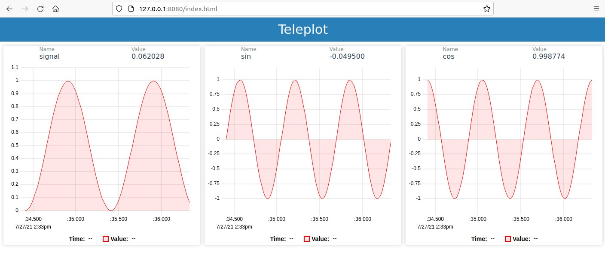

# Teleplot

A ridiculously simple tool to plot telemetry data from a running program and trigger function calls.



`echo "myData:4" | nc -u -w0 127.0.0.1 47269`

# Test it online

**Go to [teleplot.fr](https://teleplot.fr)**

# Supports

Teleplot project received the generous technical support of [Wandercraft](https://www.wandercraft.eu/).


# Start the server

## As a binary
```bash
cd server
npm i
sudo npm run-script make
./build/teleplot
```

> Current target is x64 and configurable in `package.json -> pkg/targets`

## Using node
```bash
cd server
npm i
node main.js
```

Open your navigator at [127.0.0.1:8080](127.0.0.1:8080)

## Using docker
```bash
cd server
docker build -t teleplot .
docker run -d -p 8080:8080 -p 47269:47269/udp teleplot
```

Open your navigator at [127.0.0.1:8080](127.0.0.1:8080)

## Using docker-compose
```bash
cd server
docker-compose build
docker-compose up
```

Open your navigator at [127.0.0.1:8080](127.0.0.1:8080)

# Telemetry Format

A telemetry gets published by sending a text-based UDP packet on the port `47269`. As it's a trivial thing to do on the vast majority of languages, it makes it very easy to publish from anywhere.

The telemetry format is inspired by `statsd` and *to some extents* compatible with it.

The expected format is `A:B:C§D|E` where:
- **A** is the name of the telemetry variable (be kind and avoid **`:|`** special chars in it!)
- **B** is **optional** and represents the timestamp in milliseconds (`1627551892437`). If omitted, like in `myValue:1234|g`, the reception timestamp will be used, wich will create some precision loss due to the networking.
- **C** is either the integer or floating point value to be plotted or a text format value to be displayed.
- **D** is **optional** and is the unit of the telemetry ( please avoid **`,;:|.`** special chars in it!)
- **E** is containing flags that carry information on how to read and display the data.

Examples:
- `myValue:1234`
- `myValue:1234|`
- `myValue:12.34e+2`
- `myValue:1627551892437:1234`
- `myValue:hello|t`
- `myValue:1234§km²`

### Plot XY rather than time-based

Using the `xy` flag, and providing a value in both **B** and **C** field, teleplot will display the position on a map (a 2D view), with the trail of where it went: an XY line chart.

- `trajectory:12.3:45.67|xy`

A timestamp can be associated with the xy point by adding an extra `:1627551892437` after the **C** field.

- `trajectoryTimestamped:1:1:1627551892437;2:2:1627551892448;3:3:1627551892459|xy`

The line shows as soon as two values have been received (a single one is a dot).

> Using `clr` flag when sending a telemetry will clear the previous values. This is useful when streaming cyclic data like lidar points.

### 3D points

Using the `xyz` flag and three values, teleplot displays a point in a 3D view, followed by the trail of its latest positions.

- `drone:1.5:0.2:3|xyz`

Like for `xy`, a timestamp can be added after the third value: `drone:1.5:0.2:3:1627551892437|xyz`.

### Point clouds

Using the `pc` flag, all the points of a line are one sample: a point cloud (lidar scan, depth camera...), shown in a 3D view.

- `lidar:1:0:0;0.7:0.7:0;0:1:0|pc`

Points are `x:y:z` in the frame of the sensor (a 2D scan sets z to 0). They can carry an intensity (`x:y:z:i`), a color (`x:y:z:r:g:b`) or both (`x:y:z:i:r:g:b`). A field alone at the start is the timestamp of the cloud: `lidar:1627551892437;1:0:0;0:1:0|pc`. The pose of the sensor is sent like the one of a shape: `3D|lidar:P:1:2:0.2:R:0:0:1.57`. See `doc/3d.md`.

### Publishing text format telemetries
- Using the `t` flag and giving a text telemetry (with or without timestamp), teleplot will display a text chart.

- `motor_4_state:Turned On|t`
- `motor_4_state:1627551892437:Off|t`

Text sent with `t` is a **state**: what matters is its latest value, and it is shown as a value by default. Text that is a **log** (lines to read one after the other) uses the `log` flag instead and gets a log view by default:

- `motor_4_events:Overcurrent detected|log`
- `motor_4_events:1627551892437:Back to normal|log`

Both are the same kind of data and both views display both: the flag only chooses the view a telemetry gets when nobody arranged it.

A state lasts until it changes: sending the same text again changes nothing. An empty text is a state too (`motor_4_state:|t`: nothing).
A text may hold colons (`motor_4_state:error: stalled|t`); its time, when it has one, is a first field that is a number.

A state can be a **stack**: the path of what is running, a slash between levels, with the `stack` flag (`task:loop/plan/search|stack`,
or with the time of the device `task:1627551892437.25:loop/plan|stack`). It is displayed on a timeline, a row per level, like a profiler.

Text telemetries can also be seen along the time: as bands in a **Timeline** view (a tick per line for a log), and as **marks** on a chart
they are added to. Both are views you ask for (Edit mode, or a `DASH|` line): see `doc/time-views.md`.

### Ranges and thresholds

What a number is expected between is an attribute of its telemetry, sent once with an `ATTR|` line. Its value then gets a bar, and a chart
can use the range as its scale:

- `ATTR|battery|min=9|max=12.6`

The limits a number should not pass are thresholds: a name, `<` or `>` (the side that is past the limit), a value, and a color if you want one.
Charts draw them as dashed lines, values tell which one is passed:

- `TH|battery:low<10.5:empty<9.9,red`
- `TH|motor_temp:1627551892437:hot>70` (with a time, in ms, before the name)
- `TH|battery:low<` (without value: removed)

A threshold holds from its time until another one of the same name: limits can change, and what was drawn before keeps the limit it had.
See `doc/time-views.md`.

### Publishing multiple points
/!\ here, many values will be received at the same time by teleplot, therefore you must precise their timestamps.

Multiple values of a single telemetry can be sent in a single packet if separated by a `;`

- `trajectory:1:1;2:2;3:3;4:4|xy`
- `myValue:1627551892444:1;1627551892555:2;1627551892666:3`
- `myValue:1627551892444:1;1627551892555:2;1627551892666:3§rad`
- `state:1627551892444:state_a;1627551892555:state_b|t`

### Publishing multiple telemetries

Multiple telemetries can be sent in a single packet if separated by a `\n`

```
myValue:1234
mySecondValue:1234:m/s
myThirdValue:1627551892437:1234
state:state_a|t
trajectory:1:1;2:2;3:3;4:4|xy
trajectoryTimestamped:1:1:1627551892437;2:2:1627551892448;3:3:1627551892459|xy
```

> Notice that your data needs to fit in a single UPD packet which can be limited to 512(Internet), 1432(Intranets) or 8932(Jumbo frames) Bytes depending on the network.

### Prevent auto-plot of telemetry

By default, teleplot will display all the incoming telemetry as a chart, while this is handy for new user with small amount of data, this might not be desired with lots of data.
The `np` (for no-plot) flag can be used to prevent this behavior:
- `myValue:1627551892437:1234|np`
- `trajectory:12.3:45.67|xy,np`

### Display telemetries together

A label can follow the name of a telemetry, after a comma: `name,label:value`. Telemetries that have the same label are displayed in the same view
when teleplot displays them by itself (the Live dashboard): numbers of a label share a chart, its 3D shapes a 3D view, the rest a values view.

- `left,motors:0.42`
- `right,motors:0.40`
- `state,motors:running|t`

The label is not part of the name (the telemetries above are `left`, `right` and `state`). It only decides where a telemetry first goes: views can be
rearranged freely afterwards. In the Telemetries panel each label has a card of its own, to drag all its telemetries on a dashboard at once.
A view that received a label this way (and the views teleplot made for a label by itself) follows it: telemetries that show up later with
the same label are added to it. This can be stopped per view in the edit panel.

### Choosing the dashboard, describing dashboards

A label that is a path says in which dashboard and which view a telemetry goes; both are created if needed:

- `speed,Robot/Motion:12.5`
- `accel,Robot/Motion:0.3`

A whole dashboard can be described with `DASH|` lines, one per view, addressed by the same paths:

- `DASH|Robot/Motion:chart:speed,accel|w=4|h=3`
- `DASH|Robot/side/Log:log:robot.log|maxLines=50`
- `DASH|Robot/side:column`
- `DASH|Robot/States:timeline:state,robot.log`

Lines can come in any order and be sent again at will (a line only does something when it changed). The dashboard menu exports any dashboard
as a file of such lines and imports them. The format is described in `doc/dashboard-text.md`.

### Data files

A file of text protocol lines is a data file: a device can log the lines it sends (with their time) to an SD card, and the file opens in
teleplot. The binary protocol has its file too (a short header, then each packet after its length), smaller and exact. Teleplot writes and
reads both: see `doc/files.md`. For spreadsheets and scripts there is also a CSV export (and CSV files can be opened), with a choice of
separator; numbers are always written with a point. In the webapp all of this is in the "Export and import" panel of the top menu.

### Publishing 3D telemetries

To send 3D shapes to teleplot, use this syntax : `3D|A:B:C|E`, where
**A** is the name of the shape telemetry
**B** is the timestamp of the telemetry and is **optional**
**C** is a text representing the shape
**E** is containing flags and is **optional**

Shapes live in a right-handed frame: **x forward, y left, z up** (the grid of the 3D view is the ground, z = 0). Angles are in radians.
Each shape is a telemetry: it is listed with the others, and several of them can be put in the same 3D view.
The same shapes can be sent with the binary protocol (`doc/binaryProtocol.md`); how they are displayed is described in `doc/3d.md`.

### Writing **A** (the name of the shape telemetry)

if **A** contains a comma, the text before the comma is the name of the shape telemetry and the text after it a label: shapes with the
same label are displayed in the same 3D view by default (see "Display telemetries together"). Shapes without label all share one 3D view.

If **A** doesn't contain a comma, its whole text will be considered as the name of the shape telemetry.

#### Writing **C** (the text representing the shape)

**C** is built as a concatenation of the shape properties followed by their values, the whole with colons in between.

LIST OF PROPERTIES : 

- "shape" or "S"  => the shape type ("cube", "sphere", "cylinder" or "stl").

- "url" or "U" => the url to the STL file when using this kind of "shape". **Note** as urls can cotains ":" wich is used as a delimiter in the syntax, urls are expected to be contained in `"..."` or `'...'` string delimiters. eg: `...:U:"http://my.url/file.stl":...`

- "position" or "P" => the position of the center of the shape
    1st argument : x, 2nd argument : y, 3rd argument : z
    
- "rotation" or "R" => the rotation ( in radian ) of the shape using Euler angles ( please avoid this method and use a quaternion instead )
    1st argument : the rotation around the x axis (roll), 2nd argument : the rotation around the y axis (pitch), 3rd argument : the rotation around the z axis (yaw)
    
- "quaternion" or "Q" => the rotation of the shape using a quaternion
    1st argument : x coordinate, 2nd argument : y coordinate, 3rd argument : z coordinate, 4th argument : w coordinate
    
- "color" or "C" => the color of the shape, ex : "blue", "#2ecc71" ... 

- "opacity" or "O" => the opacity of the shape, float between 0 and 1, 0 being fully transparent and 1 fully opaque ( set to 1 by default ) 

- "texture" or "T" => the texture to apply on the shape
    - 1st argument: the type of texture. Can be "url" (to load an image from an url) or "telem" (to load an image from telemetry image)
    - 2nd argument: the url of the texture, or the name of the telemetry to use
    - eg: `...:T:url:"http://my.url/file.jpg":...` or eg: `...:T:telem:myImageTelem:...`
    - The "color" property will blend with the texture, it is recommended to use a "white" or "#ffffff" color to display the expected texture

=== Size ===

- "width" or "W" => the size of the shape along the x axis
- "depth" or "D" => the size of the shape along the y axis
- "height" or "H" => the size of the shape along the z axis (up)
- "radius" or "RA" => the radius of a sphere (same as giving twice the radius as width, depth and height)
- "precision" or "PR" => accepted for compatibility with Teleplot V1, ignored (spheres and cylinders are always drawn smooth)

A cylinder stands along the z axis: W and D are its diameters, H its height. An STL file is scaled by W, D and H (1 by default: its own units).

=== Camera of an image ===

A `3D|` line sent to the name of an image telemetry describes its camera. 3D shapes and points can then be drawn over its images, as the camera saw them (image view).

- "intrinsics" or "K" => the pinhole model of the camera, in pixels
    1st argument : fx, 2nd : fy (focal lengths), 3rd : cx, 4th : cy (principal point), 5th : width, 6th : height (size of the image the parameters are given for)
- "distortion" or "DC" => the lens distortion coefficients (optional)
    1st argument : k1, 2nd : k2, 3rd : p1, 4th : p2, 5th : k3
- "position", "rotation", "quaternion" => where the camera is, in the same frame as the shapes: the camera looks along its x axis, y is to the left of the image, z to its top
- "width" or "W" => how far the camera is drawn in 3D views (as the pyramid of what it sees)

Intrinsics and distortion follow the usual image convention (the one of OpenCV and ROS: pixel 0,0 is the center of the top left pixel, u to the right, v down; Brown-Conrady distortion model).
Images are displayed as received, never undistorted: what is drawn over them is distorted like the lens does.

    - `JPG|camera:1627551892437:<base64 image>`
    - `3D|camera:K:554.3:554.3:320:240:640:480`
    - `3D|camera:1627551892437:P:1.2:0.4:0.25:Q:0:0:0.38:0.92`
    - `3D|camera:DC:-0.28:0.07:0.0002:0.0001:0`


If you don't want to send all the arguments of a certain property, you still have to add colons ( ex : position::-1:1, here the x position is not given but colons are still present )

for unspecified properties, teleplot will use the ones from the previous shape state.

Properties that were never given have a default: a cube of 1 at the origin, not rotated, opaque, in the color of its telemetry.
Every property can be changed at any time, including the shape and the color.

#### Some examples
Creating a simple sphere and cube : 

    cube without timestamp :
    - `3D|mySimpleCube:S:cube:P:1:1:1:R:0:0:0:W:2:H:2:D:2:C:#2ecc71`

    sphere with timestamp : 
    - `3D|mySimpleSphere:1627551892437:S:sphere:P::2::RA:2:C:red`

Creating a cube that grows and rotates : 

    In the first request we send, we need to specify the shape:
    - `3D|my_super_cube:S:cube:W:1:D:1:H:1:C:blue`

    Then we can specify only properties that change :
    - `3D|my_super_cube:W:1.2:R::0.2:`
    - `3D|my_super_cube:W:1.4:R::0.4:`
    - `3D|my_super_cube:W:1.6:R::0.6:`

Creating a simple sphere and cube and display them on the same widget by default :

    cube with widget label 'widget0' :
    - `3D|myCube,widget0:S:cube`

    sphere with same widget label : 
    - `3D|mySphere,widget0:S:sphere`

Importing an STL file (needs to be downloadable by teleplot, so online or locally served with proper CORS policies) :

    Import online stl file:
    - `3D|myBlueTeapot:S:stl:U:"https://upload.wikimedia.org/wikipedia/commons/9/93/Utah_teapot_%28solid%29.stl":W:0.3:H:0.3:D:0.3:C:#3498db`

    Taller teapot with rescaling:
    - `3D|myBlueTeapot:S:stl:U:"https://upload.wikimedia.org/wikipedia/commons/9/93/Utah_teapot_%28solid%29.stl":W:0.3:H:0.3:D:0.6:C:#3498db`


/!\ Despite the examples above, it might be a better idea to send every property everytime, as if teleplot refreshes or if it wasn't lauched 
before you sent certain properties, it will not have any way to be aware of the properties you sent previously. 
Therefore, it will have to use default values, or may not display anything at all, if it is not informed of the shape type for instance.

/!\ Views are drawn 30 times per second: sending a shape more often than that is not visible live (every update is stored though, and
can be seen again by hovering a chart of the same dashboard: the 3D view shows the shapes as they were at that time).

### 2D drawings, frames

A line starting with `2D|` is a `3D|` line written flat: `x:y` positions, one angle. Flat shapes (`rect`, `circle`, `line`, `polygon`, `arrow`, `text`)
are seen from above in a 2D view, and lie on the ground of a 3D view; 3D shapes show in a 2D view as what they cover. Nothing is sent twice.

- `2D|robot,field:S:rect:P:1.2:0.8:R:1.57:W:0.3:H:0.2:C:blue`
- `2D|route,field:S:line:PT:0:0:1:0.5:2:2:C:green` (add `LW:0.2` for a real width, in your units)
- `2D|zone,field:S:polygon:PT:0:0:1:0:1:1:0:1:C:red:O:0.3`
- `2D|goal,field:S:text:P:3:1:TX:"Goal A"`

With a frame, positions are relative to another telemetry, which carries them along; it works for shapes, cameras, points and point clouds, in 2D and in 3D lines:

- `2D|heading,field:S:arrow:V:0.4:0:F:robot`

A pixel frame draws in the pixels of the pictures of an image telemetry, without knowing anything about its camera (a box around what a detector found):

- `2D|det1:S:rect:P:120:80:W:40:H:60:C:red:FPX:camera`

Everything is described in `doc/2d.md`.

# Publish telemetries

## Bash

```bash
echo "myValue:1234" | nc -u -w0 127.0.0.1 47269
```

## C++

Copy `Teleplot.h` (from `clients/cpp`) in your project and use its object.
```cpp
#include <math.h>
#include "Teleplot.h"
Teleplot teleplot("127.0.0.1");

int main(int argc, char* argv[])
{
    for(float i=0;i<1000;i+=0.1)
    {
        // Use instanciated object
        teleplot.update("sin", sin(i));
        teleplot.update("cos", cos(i), 10); // Limit at 10Hz

        // Use static localhost object
        Teleplot::localhost().update("tan", tan(i));
        
        usleep(10000);
    }
    return 0;
}
```

## Python

```python
import socket
import math
import time

teleplotAddr = ("127.0.0.1",47269)
sock = socket.socket(socket.AF_INET, socket.SOCK_DGRAM)

def sendTelemetry(name, value):
	now = time.time() * 1000
	msg = name+":"+str(now)+":"+str(value)
	sock.sendto(msg.encode(), teleplotAddr)

i=0
while i < 1000:
	
	sendTelemetry("sin", math.sin(i))
	sendTelemetry("cos", math.cos(i))

	i+=0.1
	time.sleep(0.01)
```

## Serial port (Arduino, ESP32...)

Teleplot can read a serial port directly from the browser (Chrome, Edge or Opera on a computer): in the Sources panel, "Add a source", "Serial port", choose the baud rate and the port. No server is needed.

On a serial port, a line starting with `>` is telemetry, with the same format as above after the `>`. Every other line is a log line.

```cpp
void setup() { Serial.begin(115200); }
void loop() {
    Serial.print(">temperature:"); Serial.println(analogRead(A0) * 0.1);  // a telemetry
    Serial.println("still alive");                                        // a log line
    delay(50);
}
```

The Sources panel shows what the port sends (telemetry lines are hidden there until asked for) and lets you send text back to it.

## Not listed?

You just need to send a UDP packet with the proper text in it. Open your web browser, search for `my_language send UDP packet`, and copy-paste the first sample you find before editing it with the following options:
	
- address: `127.0.0.1`
- port: `47269`
- your test message: `myValue:1234|g` 

# Commands: settings and actions

The page can also change settings of your program and call its functions (telecmd, see `doc/telecmd.md`). Declare them once with
`ATTR|` lines, keep sending the values, and switch **CMD** on in the top menu of the page (it is off at every start, and only shown
when something can be commanded). The page sends back the line your program would send: read it from the socket you send from (the
Teleplot server answers to the address and port your packets come from), or from the serial port.

```
ATTR|kp|write|min=0|max=10|step=0.01          a setting: the page shows a slider; it sends kp:0.42
kp:0.4                                        keep sending the value: when it comes back as asked, the page knows it was applied
ATTR|mode|write|choices=auto,manual           a text among choices
ATTR|cmd_vel|write=pose2d|axes=x,yaw|rate=20|hold=200    driven by a joystick view; stop when nothing came for 200 ms
ATTR|goto|action|title=Go to                  an action: a button
ATTR|goto|arg=target|type=xy                  its arguments, one line each: the button opens a form
                                              the page sends !goto#12:target=1.5,2 (a call and its number)
ACK|goto#12:run                               answer run when it starts, then ok (or err:why)
ACK|goto#12:ok
```

## Python

`clients/python/teleplot.py` does all of it (declarations, echo, clamping, answers):

```python
import teleplot
tp = teleplot.Teleplot()
kp = tp.param("kp", 0.4, min=0, max=10, step=0.01)

@tp.action("goto", title="Go to", args=[teleplot.Arg("target", "xy")])
def goto(target):
    drive_to(*target)          # return a text (a result) or raise (an error)

while True:
    tp.poll()                  # reads what the page wrote, answers, publishes the settings
    controller.kp = kp.value
```

## C++

`Teleplot.h` (binary protocol):

```cpp
float kp = 0.4f;
Teleplot::ParamOptions gain; gain.min = 0; gain.max = 10; gain.step = 0.01;
Teleplot::instance().param("kp", &kp, gain);
Teleplot::instance().action("reset", [](Teleplot::Args const&) { resetOdometry(); return Teleplot::ok(); });
for (;;) { Teleplot::instance().poll(); /* use kp */ }
```

## Serial port (Arduino...)

Lines written by the page arrive on the serial port; see `clients/arduino/commands/commands.ino`.

## Send a text log

Along with telemetries, you can also send text logs to be display in a console-like manner:

`echo ">:Hello world" | nc -u -w0 127.0.0.1 47269`

By adding a millisecond timestamp to your log, you can sync them with the charts.

`echo ">1627551892437:Hello world" | nc -u -w0 127.0.0.1 47269`

# Teleplot V2 (beta)

Teleplot V2 is a rework of the library, the web application and the server. Each [release](https://github.com/nesnes/teleplot/releases) comes with:

- `teleplot-linux-x64`, `teleplot-linux-arm64`, `teleplot-macos-arm64`, `teleplot-macos-x64`, `teleplot-win-x64.exe`: the server and the web application as one executable, nothing to install. Run it, open `http://127.0.0.1:8080` and send UDP packets to port `47269`.
- `teleplot-server.zip`: the same as sources, for Node.js (`npm ci && node main.js`).
- `teleplot-webapp.zip`: the web application alone, static files to serve.
- `teleplot-js.js`: the library alone, one file to include in your own page.

The executables are not signed with a paid certificate, so the system asks before running one that was downloaded with a browser:

- Linux and macOS: make it executable with `chmod +x teleplot-macos-arm64`.
- macOS says it "could not verify" the file: close the dialog, then run `xattr -d com.apple.quarantine teleplot-macos-arm64` (or allow it in System Settings > Privacy & Security > Open Anyway).
- Windows SmartScreen: "More info", then "Run anyway".

# Project goal (future works)

Teleplot is aiming to be a simple-to-use yet powerfull telemetry visualization solution.
Teleplot is also aiming to provide remote-function-call capabilities.
Together, those goal shall make Teleplot an easy interface solution for any kind of software and application able to communicate with it.

## Project components
Teleplot provide an overall solution, but is split a few components to allow integration and various usages.
- JS library, allowing communication with Teleplot servers, data injection, and chart generation/interaction.
- Server, allowing communication with non-browser-compatible interfaces, and easing data injection in browser.
- Web application (that double as a VSCode extension), that leverage the JS library to provide an all-in-one interface to access teleplot features.
- Client libraries to use advanced and optimized features in various programming languages

## Communication interfaces
Goal is to be able to send data easily to teleplot, even without official support for a given programming language. or device.
- UDP packets: for simple network-based communication (on one or several machine)
- Serial port: for microcontroler-based connectivity

## Communication protocol
Teleplot shall offer at least 2 communication protocol:
- Text-based, Human readable, lightweight protocol to ease usage for small applications and newcomers.
- Binary, optimized (but flexible) protocol for heavy loads or limited bandwidth

## Repository structure

- `packages/teleplot-js/`
  - Shared JavaScript SDK, able of ingesting data and providing visual representations
  - built as a standalone browser bundle, and later published as an npm package 

- `packages/webapp/`
  - Extensively uses `teleplot-js`
  - Dashboard-style visualization tool for telemetry
  - Can be hosted independently

- `packages/vscode-extension/`
  - Uses the `webapp` as its GUI
  - Contains the additional wiring to make it a VSCode extension

- `packages/server/`
  - Hosts the `webapp` and forward incoming telemetry and remote commands to it
  - Options (ports, who can connect...) and messages: [doc/server.md](doc/server.md)

- `clients/{{programming_language}}` (like `bash`, `cpp`, `python`)
  - `/lib`
    - Simple-to-use library to emit telemetry and eventually access advanced teleplot features
  - `/samples`
    - Example usage code

- `doc/`
  - Architecture and protocol documentation

- `images/`
  - Project illustrations and UI previews
